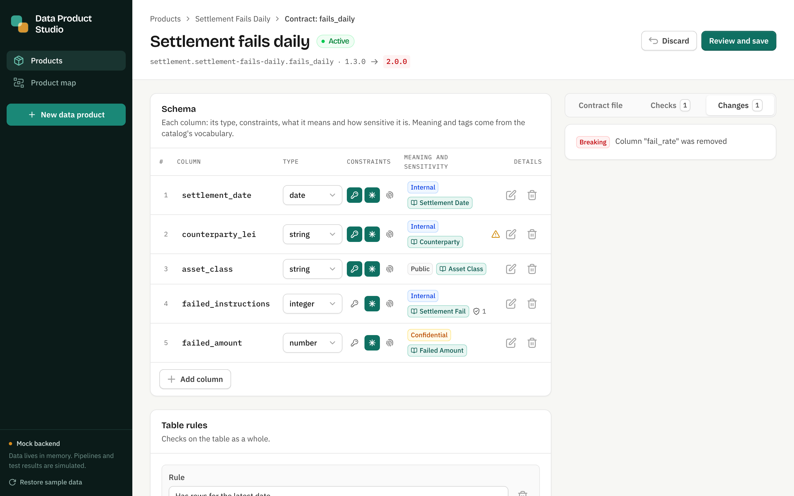
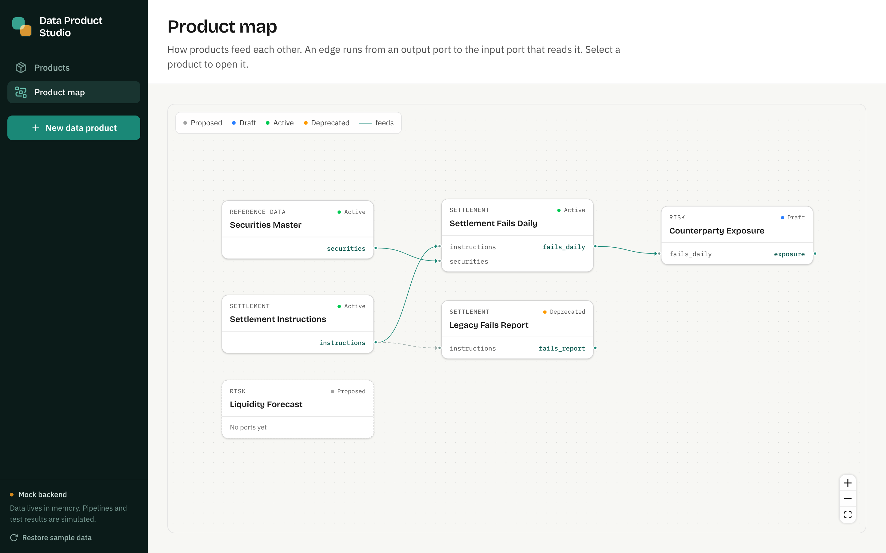

# Data Product Platform

A platform approach to data products: each product is a self-contained unit described by two open
standards — an [ODPS](https://bitol-io.github.io/open-data-product-standard/latest/) product spec
and an [ODCS](https://bitol-io.github.io/open-data-contract-standard/latest/) data contract — from
which deployments, catalog entries, lineage and policy checks are derived.

- **Design:** [`docs/superpowers/specs/2026-11-13-data-product-platform-design.md`](docs/superpowers/specs/2026-11-13-data-product-platform-design.md)
- **Built so far:** Data Product Studio, the authoring UI, on a mock backend.

## Data Product Studio

```bash
cd ui
npm install
npm run dev      # http://localhost:3000
```

What it does:

- **Products** — browse products by domain and lifecycle state, with contract and policy health.
- **New data product** — a wizard: pick a template, describe the product, choose input ports and
  carry their columns over, define the output contract, write the transformation, review the
  generated files.
- **Contract editor** — edit columns, constraints, business terms, classification, tags, quality
  rules and service levels, with the ODCS file, policy checks and the change list updating live.
  Breaking changes are detected and name the products they affect.
- **Product page** — lifecycle with the gates for the next state, ports, lineage, contract test
  results, policies, the generated files and the change history.
- **Product map** — all products and how they feed each other.





The backend is a mock: data lives in memory, and pipeline runs and test results are simulated and
labelled as such. The generated ODPS and ODCS documents are real and are validated against the
official JSON Schemas, in the UI and in `npm test`.
